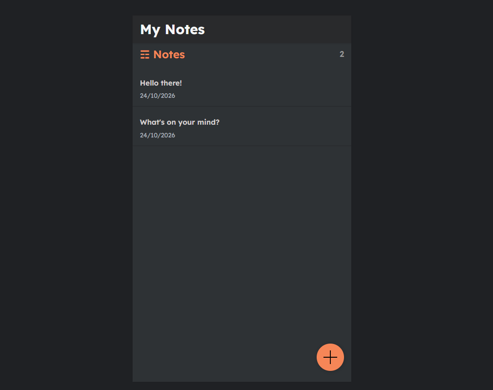
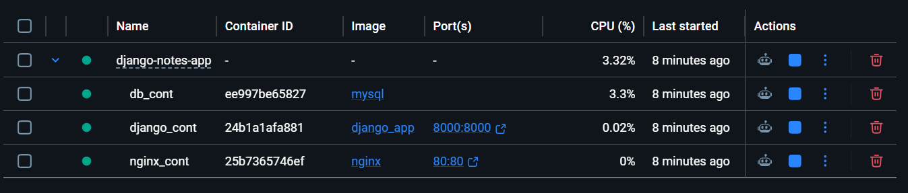
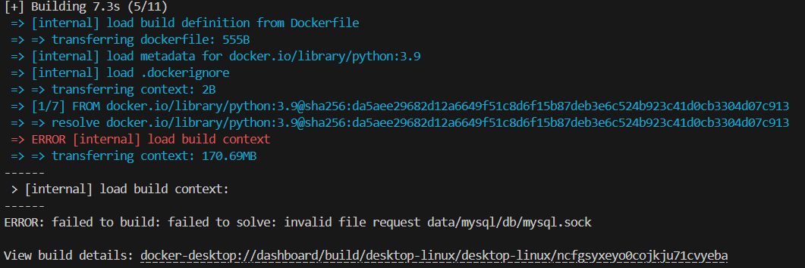
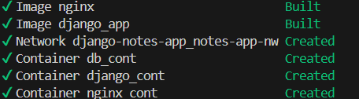

# Django Notes App: Dockerized with Nginx and MySQL

My first Docker project. A Django notes app running behind an Nginx
reverse proxy with a MySQL database, started with Docker Compose.

Based on the open-source app by [LondheShubham153](https://github.com/LondheShubham153/django-notes-app) (TWS community).



## Architecture

Browser → Nginx (port 80) → Django + Gunicorn (port 8000) → MySQL



## Run it

```bash
git clone https://github.com/Vigi-2002/django-notes-app.git
cd django-notes-app
docker compose up --build
```

Then open http://localhost

## Problems I solved

**1. Build failed with `invalid file request data/mysql/db/mysql.sock`**
The MySQL data folder (a bind mount inside the project) was part of the
build context, and Docker can't package a socket file. The context was
170 MB. Fix: added a `.dockerignore`.

**Before** (no `.dockerignore`, 170 MB context, build fails):



**After** (with `.dockerignore`, build succeeds):



**2. `pull access denied for django_app`**
Compose tried to pull a locally built image name from Docker Hub.
It falls back to building, so it was harmless. Using
`docker compose up --build` skips the pull attempt.

## What I learned

- Images, containers, networks and volumes, and how Compose ties them together
- The difference between `docker build` and `docker compose build`/`up`
- Why a `.dockerignore` matters

## Next steps

- Move credentials out of the repo into a `.env.example`
- Add healthchecks so Django waits for MySQL
- Slim down the Dockerfile and add CI with GitHub Actions
